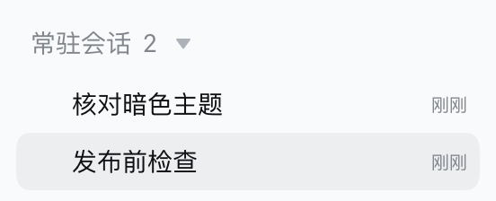
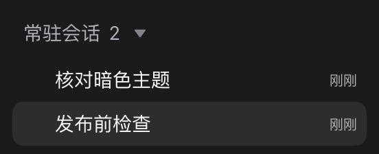
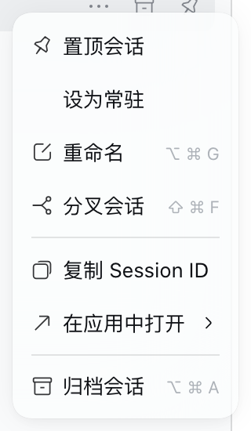
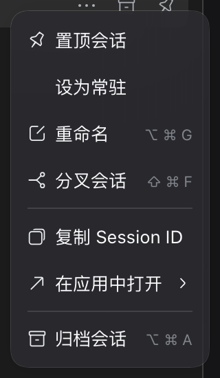

# Watched sessions

[简体中文](README.zh.md)

Keep chosen sessions in a **Watched** section at the top of the DeepSeek Harness sidebar.
Drag a session to the top drop row—or use its `…` / right-click menu—to watch, reorder,
or stop watching it (archiving a session removes it from Watched; watched items and order are stored on this client).

Click the **Watched** heading to cycle **All → Collapsed → Needs attention**; enabling **you're being watched**
on the plugin detail page switches the icons to watches, renames the heading to **Watches**,
and shows live running duration.

Requires DeepSeek Harness `0.2.2-rc.5` on Desktop or Web.
Enable **Watched sessions** in **List Modular Improvement Plan**, or run `pnpm install` in this directory
and select it in **Plugins → Add plugin**.

## Screenshots

The screenshots show the Chinese interface.

| | Light | Dark |
| --- | --- | --- |
| Watched section |  |  |
| Session menu |  |  |

[Project documentation](docs/README.md)
