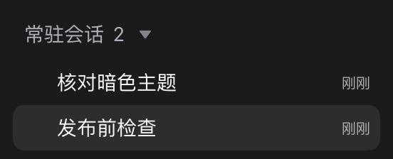
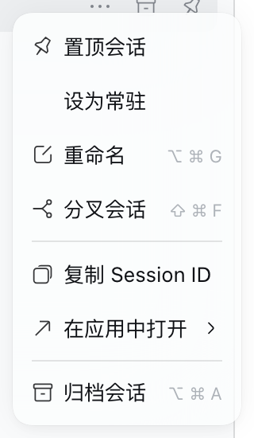
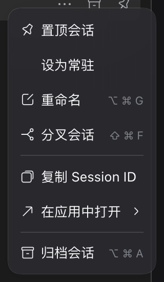

# 常驻会话

[English](README.md)

把常用会话加入 DeepSeek Harness 侧栏顶部的「常驻会话」分区。
将普通会话拖到顶部投放行，或通过行内 `…` / 右键菜单即可设为常驻、排序或取消常驻（归档会话时自动取消；
常驻列表及顺序保存在当前客户端）。

点击「常驻会话」标题按 **全部 → 收起 → 需关注** 循环切换；在插件或聚合包详情页打开 **你在被做成表** 后，
图标会换成手表、标题变为「表会话」，并显示累计运行时长。

需要 DeepSeek Harness `0.2.2-rc.5`（Desktop 或 Web）。可在 **列表模块化改良计划** 中直接开启 **常驻会话**，
或在源码目录运行 `pnpm install` 后从 **插件 → 添加插件** 选择本目录。

## 界面截图

| | 浅色 | 深色 |
| --- | --- | --- |
| 常驻会话分区 |  |  |
| 会话菜单 |  |  |

[项目文档](docs/README.md)
